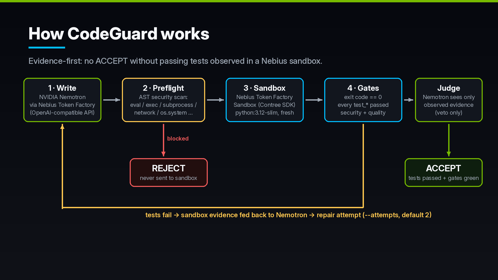
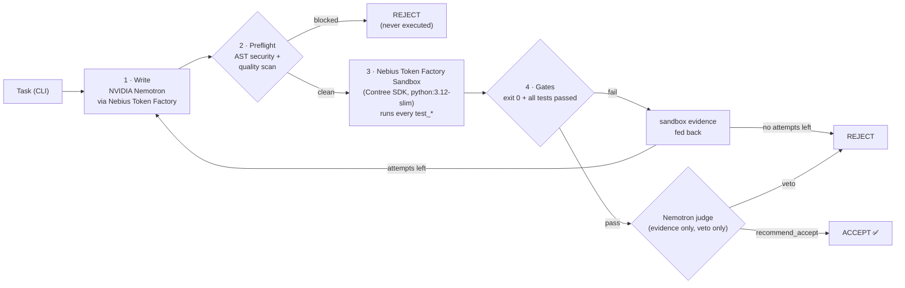
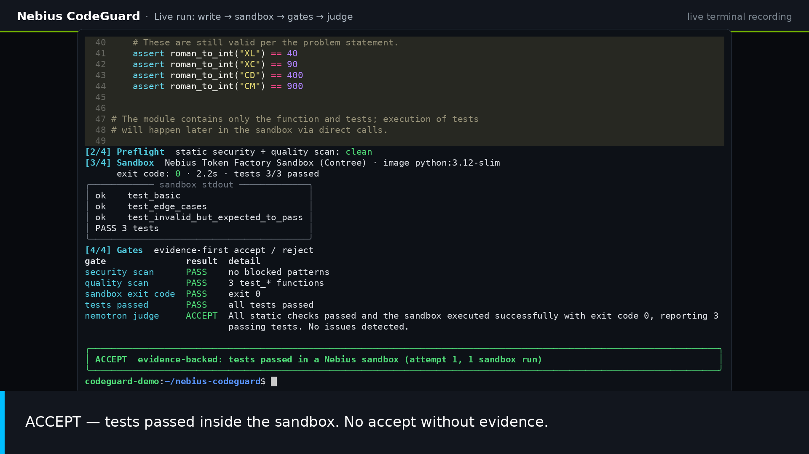
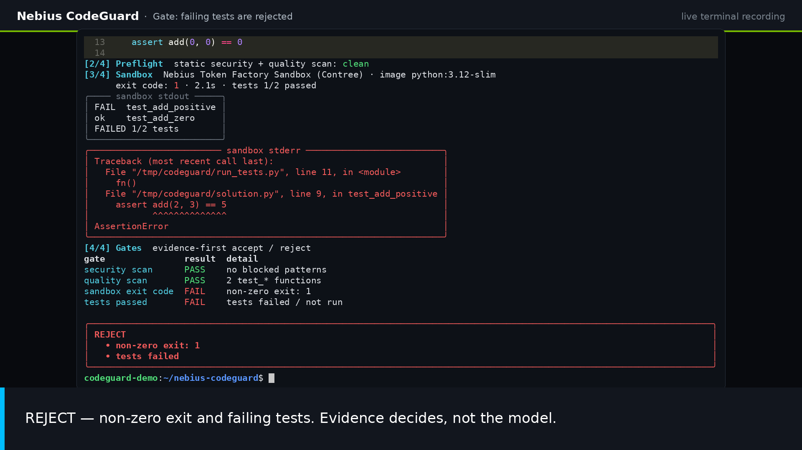
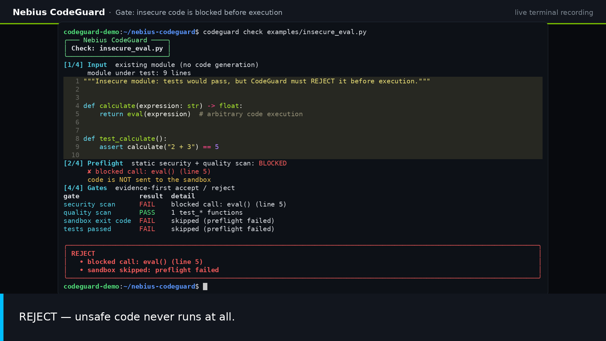

# Nebius CodeGuard

[](LICENSE)


**A coding agent that must prove its code before it ships.**
NVIDIA Nemotron (served by **Nebius Token Factory**) writes a Python module *and its tests*; the code runs in a
fresh **Nebius Token Factory Sandbox** (Contree); deterministic **quality & security gates** plus an
evidence-only Nemotron **judge** decide **ACCEPT** or **REJECT**.

Built for the **Nebius × NVIDIA Global AI Hackathon** — track **Coding and Agentic Engineering**.
Licensed under **MIT** (see [`LICENSE`](LICENSE)). 🇮🇩 [Bahasa Indonesia ↓](#bahasa-indonesia)



---

## English

### Why (the problem)

AI coding agents produce code confidently, but **confidence is not evidence**. Without isolated execution and hard
gates, broken or unsafe patches (``eval``, shell calls, network access) slip through — and running model-written code
on a developer laptop is itself a risk. CodeGuard flips the default: **nothing is accepted unless tests were actually
observed passing inside a sandbox**, and dangerous code is blocked before it ever runs.

### What it does

1. **Write** — Nemotron (`nvidia/NVIDIA-Nemotron-3-Nano-30B-A3B`) on Nebius Token Factory (OpenAI-compatible API)
   writes one self-contained Python module with ≥1 `test_*` function for your task.
2. **Preflight** — an AST-based static scan blocks `eval`/`exec`/`compile`/`__import__`, `subprocess`, `socket`,
   `ctypes`, `pickle`, `urllib`/`requests`, destructive `os.*` calls, `rm -rf /`, syntax errors and missing tests.
   **Blocked code is never sent to the sandbox.**
3. **Sandbox** — the module plus a tiny test harness are uploaded to a **fresh, disposable Nebius Token Factory
   Sandbox** (`contree-sdk`, image `python:3.12-slim`); every `test_*` function runs and is reported individually.
4. **Gates** — deterministic: exit code must be `0`, the harness must report all tests passed, security + quality
   scans must be clean.
5. **Judge** — a second Nemotron call sees **only the observed evidence** (exit code, stdout/stderr, gate results) and
   returns JSON. It can **veto** an ACCEPT but can **never override** a failed gate.
6. **Repair loop** — if gates reject, the rejection reasons and sandbox stderr are fed back to Nemotron for another
   attempt (`--attempts`, default 2).

### Architecture



| Module | Responsibility |
|---|---|
| `src/codeguard/llm.py` | OpenAI SDK client pointed at `https://api.tokenfactory.nebius.com/v1` |
| `src/codeguard/sandbox.py` | `ContreeSync()` → `images.use("python:3.12-slim")` → `run(..., files=...).wait()`; test harness |
| `src/codeguard/gates.py` | Security scan, quality scan, test-summary parsing, ACCEPT/REJECT decision |
| `src/codeguard/agent.py` | Write → preflight → sandbox → gates → judge loop, repair prompts, judge parsing (dependency-injected, unit-tested) |
| `src/codeguard/cli.py` | `codeguard run / check / scan / doctor` (Typer + Rich) |
| `src/codeguard/config.py` | Env / `.env` settings; secrets are never printed (`repr` masks the key) |

### How it uses Nebius Token Factory, NVIDIA Nemotron and Sandboxes

- **Nebius Token Factory inference** — OpenAI-compatible endpoint, used with the official `openai` Python SDK.
- **NVIDIA Nemotron** — `nvidia/NVIDIA-Nemotron-3-Nano-30B-A3B` is both the *writer* (temperature 0.3) and the *judge*
  (temperature 0.1). Both are configurable via `NEMOTRON_MODEL` / `NEMOTRON_JUDGE_MODEL`.
- **Nebius Token Factory Sandboxes (Contree, Beta)** — every candidate module runs in a fresh sandbox spawned from
  `python:3.12-slim` through `contree-sdk` 0.3.6, authenticated with the same `NEBIUS_API_KEY` +
  `NEBIUS_PROJECT_ID`. Model-written code never executes on the developer's machine.

### Setup

```bash
git clone https://github.com/kuker24/nebius-codeguard.git   # placeholder until the repo is public
cd nebius-codeguard
python -m venv .venv && source .venv/bin/activate
pip install -r requirements.txt          # runtime deps
pip install -e ".[dev]"                  # installs the `codeguard` command + pytest/ruff
cp .env.example .env                     # then fill NEBIUS_API_KEY and NEBIUS_PROJECT_ID
```

`NEBIUS_PROJECT_ID` is required by Sandboxes (Beta access must be enabled for your project).
`.env` is git-ignored; CodeGuard loads it automatically and never prints its values.

### Run

```bash
codeguard doctor                                   # safe config check (shows "set"/"MISSING", never values)
codeguard run "Write roman_to_int(s: str) -> int for valid Roman numerals I..MMMCMXCIX."
codeguard run "Write slugify(text) ..." --attempts 3 --save slugify.py
codeguard check examples/broken_add.py             # existing module → sandbox → gates (REJECT: failing test)
codeguard check examples/insecure_eval.py          # REJECT in preflight, never executed
codeguard scan  examples/insecure_eval.py          # static gates only, no network
python -m codeguard run "..."                      # same CLI without installing the entry point
python scripts/smoke_test.py                       # live end-to-end smoke (≤2 sandboxes)
```

Exit codes: `0` = ACCEPT, `1` = REJECT, `2` = configuration error.

### Example output (real run, 30 Sep 2026, trimmed)

```text
$ codeguard run 'Write roman_to_int(s: str) -> int that converts a valid Roman numeral (I to MMMCMXCIX) to an integer.'
[1/4] Write  NVIDIA Nemotron (nvidia/NVIDIA-Nemotron-3-Nano-30B-A3B) via Nebius Token Factory
      generated solution.py: 48 lines          (code listing omitted)
[2/4] Preflight  static security + quality scan: clean
[3/4] Sandbox  Nebius Token Factory Sandbox (Contree) · image python:3.12-slim
      exit code: 0 · 2.2s · tests 3/3 passed
│ ok    test_basic                        │
│ ok    test_edge_cases                   │
│ ok    test_invalid_but_expected_to_pass │
│ PASS 3 tests                            │
[4/4] Gates  evidence-first accept / reject
gate               result  detail
security scan      PASS    no blocked patterns
quality scan       PASS    3 test_* functions
sandbox exit code  PASS    exit 0
tests passed       PASS    all tests passed
nemotron judge     ACCEPT  All static checks passed and the sandbox executed successfully with exit code 0, reporting 3
                           passing tests. No issues detected.
│ ACCEPT  evidence-backed: tests passed in a Nebius sandbox (attempt 1, 1 sandbox run) │
```

A repair-loop run (`slugify`) failed attempt 1 in the sandbox (`FAILED 1/3 tests`, `AssertionError` on
`"Café-au-lait!!!"`), received the evidence, added Unicode normalisation, and passed attempt 2 (`PASS 3 tests`).
Rejections look like this:

```text
$ codeguard check examples/insecure_eval.py
[2/4] Preflight  static security + quality scan: BLOCKED
      ✘ blocked call: eval() (line 5)
      code is NOT sent to the sandbox
│ REJECT  • blocked call: eval() (line 5)  • sandbox skipped: preflight failed │
```

| Live ACCEPT | Failing test → REJECT | Insecure → REJECT |
|---|---|---|
|  |  |  |

### Tests

```bash
pytest -q                 # 62 offline unit tests (no network): gates, agent loop with fakes, harness, config
pytest -m live            # optional: spawns 1 real sandbox; needs NEBIUS_API_KEY + NEBIUS_PROJECT_ID in the env
ruff check src tests scripts
```

Live tests are deselected by default (`addopts = -m 'not live'`) and skipped when credentials are absent.

### Gates in detail

| Gate | Rejects when | Where |
|---|---|---|
| Security scan | `eval/exec/compile/__import__/breakpoint` calls; imports of `subprocess, socket, ctypes, pickle, marshal, shutil, multiprocessing, pty, requests, urllib, http, ftplib, telnetlib, smtplib`; `os.system/popen/remove/unlink/rmdir/kill/fork/exec*/spawn*`; the text `rm -rf /`. Falls back to substring patterns if the code doesn't parse. | before sandbox **and** in final decision |
| Quality scan | empty source, syntax error, fewer than 1 top-level `test_*` function | before sandbox and final |
| Sandbox exit code | no exit code (sandbox did not run / errored) or non-zero exit | after sandbox |
| Tests passed | harness did not print `PASS n tests` (n>0) with exit 0 | after sandbox |
| Nemotron judge | returns `recommend_accept: false` (veto). Unparseable replies are advisory only. | only after all gates pass |

### Limitations

- Single-file Python tasks only; the model writes its own tests, so test quality is bounded by the model (the judge
  and the gates check evidence, not test adequacy — no coverage or mutation testing yet).
- The security policy is a deliberately strict denylist for self-contained toy tasks; it is not a general-purpose
  sandbox-escape or malware detector. Real isolation comes from the Nebius sandbox itself.
- One sandbox run per attempt, sequential; no parallel candidate branches or checkpoint reuse yet.
- Sandboxes is a Beta service and requires project-level access; runs cost Token Factory credits.
- CLI only — no hosted web UI.

### Roadmap

Parallel candidates with sandbox checkpoints/branches, coverage and property-based gates, multi-file repo patches
(diff + existing test suite), and a hosted API.

### License

[MIT](LICENSE) © 2026 Fahmi Harun and Nebius CodeGuard contributors.

---

## Bahasa Indonesia

### Apa itu CodeGuard?

**Nebius CodeGuard** adalah agen coding yang **wajib membuktikan kodenya sebelum diterima**. NVIDIA Nemotron (lewat
**Nebius Token Factory**) menulis modul Python *beserta test-nya*; kode dijalankan di **Nebius Token Factory Sandbox**
(Contree) yang baru dan sekali pakai; lalu **gerbang kualitas & keamanan** yang deterministik plus **juri** Nemotron
yang hanya melihat bukti memutuskan **ACCEPT** atau **REJECT**.

### Kenapa (masalahnya)

Agen AI menulis kode dengan percaya diri, tapi **percaya diri bukan bukti**. Tanpa eksekusi terisolasi dan gerbang
yang tegas, patch yang rusak atau berbahaya (`eval`, perintah shell, akses jaringan) bisa lolos — dan menjalankan
kode buatan model di laptop developer juga berisiko. CodeGuard membalik default-nya: **tidak ada yang diterima kecuali
test benar-benar terlihat lulus di dalam sandbox**, dan kode berbahaya diblokir sebelum sempat dijalankan.

### Cara kerja

1. **Tulis** — Nemotron (`nvidia/NVIDIA-Nemotron-3-Nano-30B-A3B`) di Token Factory (API kompatibel OpenAI) menulis
   satu modul Python mandiri dengan minimal satu fungsi `test_*`.
2. **Preflight** — pemindaian statis berbasis AST memblokir `eval`/`exec`, `subprocess`, `socket`, panggilan `os`
   yang destruktif, dll. **Kode yang diblokir tidak pernah dikirim ke sandbox.**
3. **Sandbox** — modul + harness test diunggah ke **Nebius Token Factory Sandbox** baru (`contree-sdk`,
   image `python:3.12-slim`); setiap `test_*` dijalankan dan dilaporkan.
4. **Gerbang** — exit code harus `0`, semua test lulus, scan keamanan & kualitas bersih.
5. **Juri** — panggilan Nemotron kedua hanya melihat bukti (exit code, stdout/stderr, hasil gerbang). Juri bisa
   **memveto** ACCEPT, tapi **tidak pernah bisa membatalkan** gerbang yang gagal.
6. **Loop perbaikan** — jika ditolak, alasan + stderr sandbox dikirim balik ke Nemotron untuk percobaan berikutnya
   (`--attempts`, default 2).

Diagram arsitektur: lihat bagian [Architecture](#architecture) di atas.

### Pemakaian Nebius + NVIDIA

- **Token Factory (inference)**: endpoint kompatibel OpenAI `https://api.tokenfactory.nebius.com/v1` via SDK `openai`.
- **NVIDIA Nemotron**: `nvidia/NVIDIA-Nemotron-3-Nano-30B-A3B` sebagai penulis kode dan juri.
- **Token Factory Sandboxes (Contree, Beta)**: `contree-sdk` 0.3.6, satu sandbox baru per percobaan; kode buatan model
  tidak pernah jalan di mesin developer.

### Setup

```bash
python -m venv .venv && source .venv/bin/activate
pip install -r requirements.txt
pip install -e ".[dev]"
cp .env.example .env      # isi NEBIUS_API_KEY dan NEBIUS_PROJECT_ID (jangan pernah di-commit)
```

### Menjalankan

```bash
codeguard doctor
codeguard run "Tulis fungsi roman_to_int(s: str) -> int untuk angka Romawi I..MMMCMXCIX."
codeguard check examples/broken_add.py      # REJECT: test gagal di sandbox
codeguard check examples/insecure_eval.py   # REJECT: diblokir preflight, tidak dijalankan
python scripts/smoke_test.py                # smoke test live end-to-end
```

### Test

```bash
pytest -q          # 62 unit test offline (tanpa jaringan)
pytest -m live     # opsional: 1 sandbox sungguhan, butuh kredensial di environment
```

### Status

- [x] Struktur repo + CLI (`run`, `check`, `scan`, `doctor`)
- [x] Integrasi Sandboxes end-to-end (live: Nemotron → sandbox → gerbang → juri, 30 Sep 2026)
- [x] Unit test offline + penanda test live
- [x] Video demo ≤ 3 menit (dibuat lokal)
- [ ] Repo publik (GitHub) — menunggu konfirmasi
- [ ] Submit Devpost — menunggu konfirmasi

### Keterbatasan

Hanya tugas Python satu file; kualitas test bergantung pada model; kebijakan keamanan berupa denylist ketat untuk
tugas mandiri (isolasi sebenarnya dari sandbox Nebius); belum ada kandidat paralel/checkpoint; Sandboxes masih Beta.

### Lisensi

[MIT](LICENSE) © 2026 Fahmi Harun dan kontributor Nebius CodeGuard.
